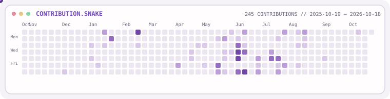

<picture>
  <source media="(prefers-color-scheme: dark)" srcset="assets/dark.svg">
  <source media="(prefers-color-scheme: light)" srcset="assets/light.svg">
  
</picture>

  <a href="https://trancheprotocol.xyz">Website</a> ·
  <a href="https://x.com/macanthonyeke">X</a> ·
  <a href="https://github.com/macanthonyeke">GitHub</a> ·
  <a href="mailto:macanthonyeke@gmail.com">Email</a>

<picture>
  <source media="(prefers-color-scheme: dark)" srcset="assets/snake-dark.svg">
  <source media="(prefers-color-scheme: light)" srcset="assets/snake-light.svg">
  
</picture>
